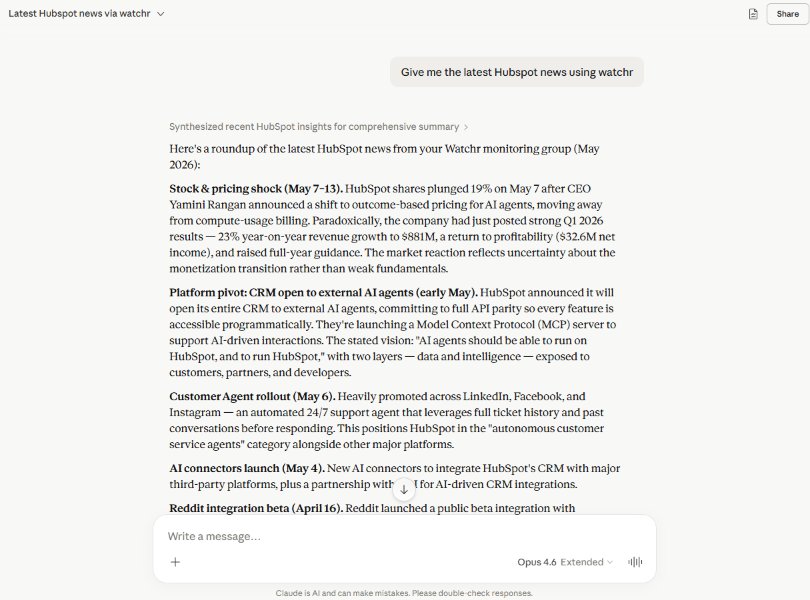
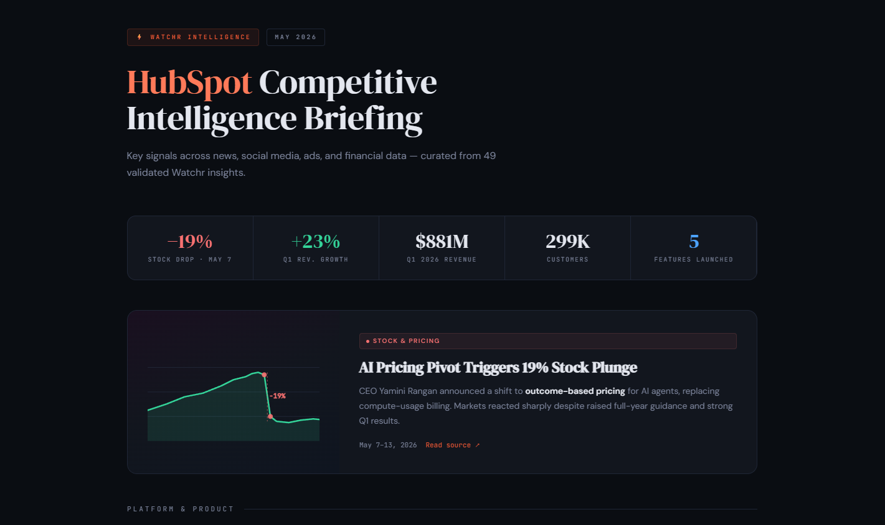
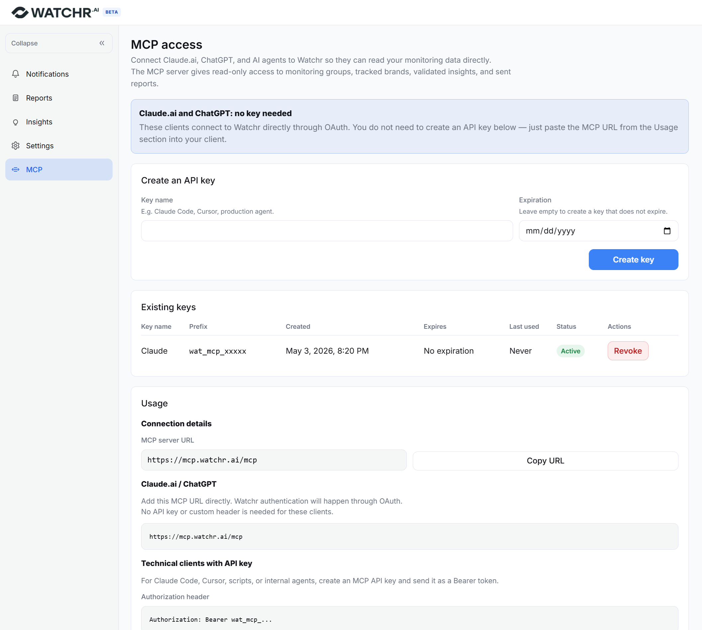

# Watchr MCP Server

> Bring competitive intelligence and brand monitoring into your AI assistant. Ask Claude, Cursor, or any MCP-compatible client what your competitors did this week. Answers come straight from your [Watchr](https://www.watchr.ai) workspace.

[Watchr](https://www.watchr.ai) is a competitive intelligence and brand monitoring platform. It watches your competitors' websites, ads, social posts, news, and other sources, then qualifies each signal against a prompt you define, so what you see is *relevant* movement, not noise.

This repository documents the official **Model Context Protocol (MCP) server** for Watchr. It exposes account-scoped data and controlled account workflows. API keys provide read access; authorized OAuth administrators can also configure watchlists, manage members, record feedback and manage account tags.

The server is hosted by Watchr. No local install, no Docker. Just point your client at `https://mcp.watchr.ai/mcp` and authenticate. There are two paths, depending on your client:

- One-click OAuth for Claude (Desktop / Code), ChatGPT, Cursor and any other client supporting Dynamic Client Registration. Browser opens, you approve, done.
- Personal API key (generated in your Watchr workspace) for agentic frameworks and custom integrations where you embed the MCP into your own automation stack.

---

## Table of contents

- [What you can do with it](#what-you-can-do-with-it)
- [Showcase](#showcase)
- [Available tools](#available-tools)
- [Insight response contract](#insight-response-contract)
- [Onboarding skill for Claude Code and Codex](#onboarding-skill-for-claude-code-and-codex)
- [Getting started with Watchr](#getting-started-with-watchr)
- [Authentication](#authentication)
  - [Option A. One-click OAuth](#option-a-one-click-oauth)
  - [Option B. Personal API key](#option-b-personal-api-key)
- [Configuration](#configuration)
  - [OAuth clients](#oauth-clients)
  - [API key clients](#api-key-clients)
- [Improving your results](#improving-your-results)
- [Support](#support)

---

## What you can do with it

Once connected, you can ask your AI assistant things like:

- *"What did our competitors launch this week?"*
- *"Draft a Slack message summarizing the top 5 competitive insights from this month."*
- *"Compare positioning changes across our tracked brands over the last 30 days."*
- *"Build me a one-page competitive briefing on HubSpot from the last month, make it visual."*
- *"Automatically update my Notion battle cards and competitor recap pages with this week's Watchr insights."*

The MCP server provides the data; your assistant handles the reasoning, drafting, and integration with the rest of your workflow.

## Showcase

A short conversation with Claude pulling the latest HubSpot signals through Watchr:



Same data, one follow-up prompt later. Claude generates a designed competitive briefing artifact directly from the validated Watchr insights:



This is the core loop. Watchr collects and qualifies. Your AI client reasons and outputs. The MCP server is the glue.

## Available tools

The default endpoint exposes **37 tools**, including reads and writes. The dedicated ChatGPT profile exposes **62 tools**, with individually named configuration preview/apply actions. Runtime `tools/list` is the source of truth for arguments, schemas and permissions.

| Tool | Purpose |
|---|---|
| `list_monitoring_groups` | List all monitoring groups (watchlists) you have access to. Each group bundles one or more tracked brands and a custom qualifying prompt that defines what counts as relevant. |
| `list_brands` | List the competitor brands tracked inside a monitoring group. Use this to resolve brand names before searching. |
| `search_insights` | Search validated insights with filters (brand, date range, source type, free-text). Returns a compact list designed to decide which insights to open. |
| `get_insight` | Fetch the full body of a single insight by ID: source URL, original content, screenshots, qualifying rationale, dates, and related items when available. |
| `list_reports` | List reports that have been sent from a monitoring group. |
| `get_report` | Fetch the full body of a single report: narrative, included insights, recipients, send date. |
| `get_workspace_context` | Read role, credential scopes, effective permissions and account limits. |
| `list_watchr_documentation` | Discover product guides and supported capabilities. |
| `get_watchr_guide` | Read a selected product guide. |
| `get_monitoring_configuration` | Read brands, sources, goals, relevance and report settings. |
| `diagnose_monitoring` | Read configuration diagnostics and recorded report counters when available. |
| `preview_monitoring_changes` | Save a bounded configuration preview without applying it. |
| `apply_monitoring_changes` | Apply the exact approved preview, rechecking permissions and entitlements. |
| `get_operation_status` | Read operation progress, pending confirmation or partial failure. |
| `set_report_email_delivery` | Preview the combined report-generation and email-delivery setting. |
| `list_workspace_members` | Read account members and pending invitations. |
| `invite_workspace_member` | Invite a member with an explicitly authorized role. |
| `revoke_workspace_invitation` | Revoke an explicitly identified pending invitation. |
| `update_workspace_member_role` | Change a member role, protecting the final administrator. |
| `remove_workspace_member` | Remove member access and revoke corresponding connections. |
| `list_insight_tags` | Read the account tag catalog, definitions and versions. |
| `check_insight_tag` | Validate a proposed tag and expose overlap warnings without saving. |
| `save_insight_tag` | Create, edit, archive or reactivate an account tag. |
| `update_insight_tags` | Add, remove or replace tags on a bounded batch of insights. |
| `get_insight_tags` | Read tags, manual exclusions and classification state for selected insights. |
| `get_insight_tag_history` | Read the bounded tag correction and classification audit. |
| `create_insight_tag_job` | Prepare an explicit classification job with IDs and budget limits. |
| `run_insight_tag_job` | Advance a job by at most one external model call within its limits. |
| `get_insight_tag_job` | Read job progress and reserved budget without running it. |
| `list_watchr_skills` | Discover packaged methods and their resource files. |
| `get_watchr_skill` | Read a packaged skill file. |
| `search_signals` | Search watchlist-scoped topics and synchronize their changes. |
| `get_signal` | Read a topic with paginated source and report references. |
| `search_rejected_insights` | Search retained individual rejected sources and their reasons. |
| `get_rejected_insight` | Read an accessible retained rejection with its original evidence. |
| `record_insight_feedback` | Record an explicit relevance, homonym or duplicate judgment without hiding the source. |
| `list_insight_feedback` | Read recorded judgments and their provenance. |

Collections support their documented pagination and filters. Configuration uses a persistent preview followed by explicit approval before application. Reads require `mcp:read`; configuration and tag writes additionally require `mcp:configure`; member administration requires `mcp:members:manage`. Current roles and permissions are checked server-side. API keys remain read-only.

Previewing does not start collection, send emails or apply a change. Some apply actions launch external discovery or collection. Tag definitions do not reclassify history: classification jobs are explicit, bounded and budgeted, and preserve manual corrections by default. Recorded relevance feedback does not change qualification or perform replay.

New MCP-created watchlists have report preparation and email delivery disabled by default. Those two effects share one setting; disabling it does not stop collection. Existing report preferences are preserved.

## Insight response contract

`search_insights` returns a compact discovery payload. Every item includes an `id`, a title, a factual summary, source and brand metadata, and an `effective_date`. The accompanying `date_type` says whether that effective date is the source publication date (`published`) or Watchr's detection date (`detected`). Website changes therefore remain safely dateable even when they have no publication date.

The search response intentionally omits the original `description`, `qualification_analysis`, raw dates, and `related_items`. This keeps result pages small enough for an AI client to rank and shortlist without spending its context window on source text it may never use.

When an item's title or summary is not clear enough, call `get_insight` with the returned `id` as `insight_id` before answering. `get_insight` provides the source description, qualification reasoning, published and detected dates, and any related validated insights. Consumers should not infer missing detail from the compact summary alone.

`search_signals` and `get_signal` expose watchlist-scoped topics, source relations and recorded report appearances. `competitive_signal_id` is a legacy shared grouping hint, not the authoritative topic identity. Historical report appearances may be unavailable when no structure was recorded. A stored snapshot timestamp is not proof of the actual screenshot capture time.

## Onboarding skill for Claude Code and Codex

The [Watchr onboarding skill](skills/watchr-onboarding/SKILL.md) helps an authorized assistant read your current setup, prepare a first watchlist or improve an existing one, show the exact preview, and verify the result after your approval. The skill and the MCP connection are separate: installing the skill does not grant access or change your account.

To install it for one project, copy the entire `skills/watchr-onboarding/` directory from this repository to `.claude/skills/watchr-onboarding/` for Claude Code or `.agents/skills/watchr-onboarding/` for Codex. For a personal installation, use `~/.claude/skills/watchr-onboarding/` or `~/.agents/skills/watchr-onboarding/` respectively. Keep both `SKILL.md` and `agents/openai.yaml` together.

Connect Claude Code with `claude mcp add --transport http watchr https://mcp.watchr.ai/mcp`, then authorize through `/mcp`. Connect Codex with `codex mcp add watchr --url https://mcp.watchr.ai/mcp/chatgpt`, then run `codex mcp login watchr`. Complete Watchr sign-in only in the browser. Once connected, ask your assistant to use the Watchr onboarding skill.

The dedicated signup page for people starting without a Watchr account is still in development. Until it is available, the skill does not provide a signup URL or claim to complete that flow. Claude Code and Codex OAuth onboarding with a new empty account has not yet been validated end to end.

## Getting started with Watchr

You need a configured Watchr workspace before the MCP server has anything interesting to return. The full path:

1. Create an account at [watchr.ai/signup](https://www.watchr.ai/signup). A free tier is available.
2. Finalize your settings at [watchr.ai/app/settings](https://www.watchr.ai/app/settings):
   - Add the brands and competitors you want to track
   - Specify the market you are monitoring (used to qualify relevance)
   - Subscribe to the newsletters and press feeds you want pulled in
   - Add the pages you want Watchr to monitor for changes (pricing, changelog, careers, etc.)
   - Add social media profiles to scrape (LinkedIn, Facebook, Instagram)
3. Wait for the first collected insights. Report preparation and delivery depend on watchlist settings; requesting a chat recap does not enable scheduled reports.
4. Connect the MCP server (see [Authentication](#authentication) and [Configuration](#configuration)) and start querying your insights from any AI client.

## Authentication

The default endpoint is `https://mcp.watchr.ai/mcp`. The dedicated ChatGPT profile uses `https://mcp.watchr.ai/mcp/chatgpt`. There are two authentication methods, depending on the client.

### Option A. One-click OAuth

Standard OAuth 2.1 with Dynamic Client Registration (RFC 7591) and PKCE. Your client self-registers, opens a browser window, you authorize Watchr access, and tokens are stored transparently by the client. No copy/paste, no manual rotation.

OAuth clients can use the authorization flow above:

- Claude Desktop
- Claude Code
- ChatGPT, using its dedicated endpoint and the connector/plugin setup available to the account
- Cursor (recent versions)

If your client is in this list, jump straight to [OAuth clients](#oauth-clients). No key generation needed.

### Option B. Personal API key

For agentic frameworks, custom integrations, scripts, Windsurf, VS Code extensions, or any client that doesn't support OAuth, Watchr issues long-lived API keys prefixed with `wat_mcp_`.

To generate a key:

1. Sign in at [watchr.ai](https://www.watchr.ai)
2. Go to **Integrations → MCP** in your workspace
3. Click **Create API key**
4. Give it a descriptive name (e.g. *"My LangGraph agent"*, *"Windsurf, work laptop"*), optionally set an expiry date
5. Copy the key immediately. Watchr only displays the full key once. The dashboard stores a prefix and a hash, so a lost key cannot be recovered (revoke and regenerate).



Pass the key as a Bearer token on every request:

```
Authorization: Bearer wat_mcp_<your-key>
```

Most MCP clients let you declare this via a `headers` field in their config. Examples in [API key clients](#api-key-clients).

A few notes on security:

- Treat the key like a password. Read-only doesn't mean low-risk: it can see all your competitive intelligence.
- One key per device or integration, named clearly. Revoke and re-issue from **Integrations → MCP** if a laptop is lost.
- Set an expiry date on keys for CI or shared environments.
- Keys inherit your account's access. They cover every active monitoring group in the account.

Don't have a Watchr account yet? [Create one for free](https://www.watchr.ai/signup).

## Configuration

### OAuth clients

For all clients below, the server URL is `https://mcp.watchr.ai/mcp` and authentication is triggered automatically on first connection.

#### Claude Desktop

Edit `claude_desktop_config.json` (Settings → Developer → Edit Config):

```json
{
  "mcpServers": {
    "watchr": { "url": "https://mcp.watchr.ai/mcp" }
  }
}
```

Restart Claude Desktop. Watchr appears in the connectors panel. Click it to complete OAuth.

#### Claude Code

```bash
claude mcp add --transport http watchr https://mcp.watchr.ai/mcp
```

Then run `/mcp` inside Claude Code and click **Authenticate** next to Watchr.

#### ChatGPT

Settings → Connectors → **Add custom connector**:

- MCP server URL: `https://mcp.watchr.ai/mcp`
- Authentication: OAuth

ChatGPT triggers the OAuth flow on first use.

#### Cursor

Settings → MCP → **Add new MCP server**:

```json
{
  "watchr": { "url": "https://mcp.watchr.ai/mcp" }
}
```

### API key clients

First [generate an API key](#option-b-personal-api-key), then pass it as a Bearer token in the client config.

#### Windsurf

Add to `~/.codeium/windsurf/mcp_config.json`:

```json
{
  "mcpServers": {
    "watchr": {
      "serverUrl": "https://mcp.watchr.ai/mcp",
      "headers": { "Authorization": "Bearer wat_mcp_<your-key>" }
    }
  }
}
```

#### VS Code

Add to `.vscode/mcp.json` (or user settings):

```json
{
  "servers": {
    "watchr": {
      "type": "http",
      "url": "https://mcp.watchr.ai/mcp",
      "headers": { "Authorization": "Bearer wat_mcp_<your-key>" }
    }
  }
}
```

#### Cursor (without OAuth)

Same JSON shape as the OAuth version with an added `headers` block:

```json
{
  "watchr": {
    "url": "https://mcp.watchr.ai/mcp",
    "headers": { "Authorization": "Bearer wat_mcp_<your-key>" }
  }
}
```

#### Custom agentic frameworks

LangGraph, CrewAI, Mastra, n8n, custom Python or TypeScript agents, etc. Connect to `https://mcp.watchr.ai/mcp` over streamable HTTP and attach the header `Authorization: Bearer wat_mcp_<your-key>` to every request. Any MCP-compatible SDK works.

## Improving your results

If your assistant says it has "no relevant insights" or returns thin results, the data lives upstream in your Watchr workspace. Make Watchr smarter and the MCP gets smarter:

- Add monitored pages (competitor pricing, changelog, careers, product pages)
- Complete social profiles by adding LinkedIn, Facebook, Instagram handles for each tracked brand
- Refine the qualifying prompt at the monitoring-group level. It decides what counts as "relevant". Tighten it (more specific themes you care about) or broaden it (catch more) based on what's getting through.
- Add more news and press sources. The more sources, the higher the signal density.

Everything is configurable at [watchr.ai/app/settings](https://www.watchr.ai/app/settings).

## Support

- Bug reports and feature requests: [open an issue](https://github.com/getwatchr/watchr-mcp/issues) in this repo
- General questions and feedback: [contact@watchr.ai](mailto:contact@watchr.ai)
- Status and uptime: the MCP endpoint shares status with the main Watchr platform

---

Built by the [Watchr](https://www.watchr.ai) team. MIT licensed.
